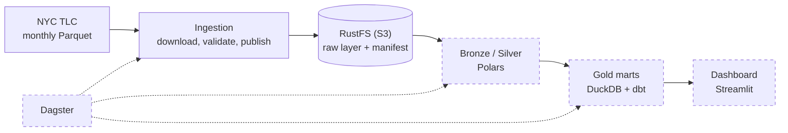

# CityFlow Analytics

Portable data platform on NYC taxi data: reliable ingestion, layered storage, analytics.

[](https://github.com/mihail-goncharov/cityflow/actions/workflows/ci.yml)


## Overview

Public datasets change, downloads fail halfway, and pipelines get rerun.
A data platform has to give the same result every time it runs.

CityFlow processes monthly NYC TLC Yellow Taxi data through ingestion,
layered object storage, data quality rules, analytical marts and a
dashboard. It is designed to run consistently on a laptop, a Proxmox
homelab or a cloud VM.

The ingestion layer is currently complete: one command downloads a
monthly dataset, validates it and publishes it to S3-compatible storage
safely and repeatably.

Built during a mentored internship (October to December 2026). Development
happens on a self-hosted Forgejo; this repository is a read-only mirror.

## Demo

The first run publishes January 2025; the second finds it already published
and writes nothing:

```console
$ uv run --locked --env-file .env python -m cityflow.ingestion --month 2025-01
2026-11-11 14:43:12,566 INFO cityflow.ingestion: Ingestion of 2025-01 finished: published

$ uv run --locked --env-file .env python -m cityflow.ingestion --month 2025-01
2026-11-11 14:44:03,186 INFO cityflow.ingestion: Ingestion of 2025-01 finished: skipped
```

A failure logs the stage that failed (`config`, `download`, `validate` or
`publish`) and exits with code 1; an invalid `--month` exits with code 2.

## Architecture

Dashed boxes are planned.



| Stage | What it does |
|---|---|
| Download | Streams the month's file from the TLC source; retries transient errors |
| Validate | Checks the file against the raw data contract before anything is uploaded |
| Publish | Uploads the unchanged file with a `manifest.json` and verifies what was stored |

## Tech stack

| Area | Technology | Status |
|---|---|---|
| Language and environment | Python 3.13, uv | Implemented |
| Data processing | Polars, Parquet | Implemented |
| Ingestion | httpx | Implemented |
| Object storage | RustFS (S3-compatible), boto3 | Implemented |
| Testing | pytest, pytest-cov, moto | Implemented |
| Code quality and security | Ruff, mypy, pip-audit, Gitleaks | Implemented |
| CI/CD | Forgejo Actions, GitHub Actions | Implemented |
| Local infrastructure | Docker Compose | Implemented |
| Analytics and modeling | DuckDB, dbt | Planned |
| Orchestration | Dagster | Planned |
| Dashboard | Streamlit, Plotly | Planned |

## Reliability

- **Safe reruns:** a manifest beside each month records what was published, so
  a rerun is skipped and an interrupted run is completed, never duplicated.
- **No silent overwrites:** if the source file changed after publication, the
  run stops with an error and the published data is kept for manual review.
- **One publisher at a time:** a conditional write lets only one run publish a
  given month.
- **Verified uploads:** stored bytes are checked by SHA-256 against the
  downloaded file.
- **No bad data in storage:** every file is validated against a data contract
  before upload, and raw bytes are never modified.

## Quick start

Requirements: Git and [uv](https://docs.astral.sh/uv/getting-started/installation/)
(uv installs Python 3.13 itself).

```bash
git clone https://github.com/mihail-goncharov/cityflow.git
cd cityflow
uv sync --locked
uv run pytest -q
```

The tests use synthetic data and fakes for HTTP and S3, so they need no
network, data or credentials. CI fails below 80% branch coverage.

Ingestion needs your own S3-compatible object storage; the project is
developed and tested against RustFS. Create your `.env` from the template, fill in the `S3_*`
values for your storage and never commit the file:

```bash
cp .env.example .env
```

| Variable | Meaning |
|---|---|
| `S3_ENDPOINT_URL` | S3 API endpoint of your storage |
| `S3_ACCESS_KEY`, `S3_SECRET_KEY` | S3 credentials |
| `S3_BUCKET` | bucket that holds the raw layer; it must already exist, ingestion does not create buckets |

Then run ingestion for January 2025:

```bash
uv run --locked --env-file .env python -m cityflow.ingestion --month 2025-01
```

The month is stored under `raw/nyc_tlc/yellow_taxi/year=2025/month=01/`
together with its `manifest.json`.

A local RustFS setup is in preparation.

## Results: January 2025

Profiling with `profile_data.py`:

- 3,475,226 trips, 20 columns, about 59 MB of Parquet.
- 224,031 rows (6.45%) fail quality rules: zero or negative fares, zero
  distance, trips over 5 hours, impossible timestamps.
- 15.5% of rows (Flex Fare trips) have no passenger count, rate code or
  surcharge data.

| Metric (3,251,195 valid trips) | Value |
|---|---|
| Average fare | $17.95 |
| Average distance | 3.17 miles |
| Average duration | 14 min 41 s |
| Busiest hour | 18:00–19:00 |
| Top pickup zone | Midtown Center, Manhattan |

## Roadmap

Target: an end-to-end demo by 11 December 2026.

| Stage | Status |
|---|---|
| Environment and dataset profiling | Done |
| S3 storage adapter | Done |
| Batch ingestion and raw data contract | Done |
| CI quality gates | Done |
| Bronze/Silver transformations | In progress |
| Gold analytical marts | Planned |
| Orchestration with Dagster | Planned |
| Dashboard with Streamlit | Planned |
| Access control, backup, monitoring and deployment | Planned |

## Repository layout

```
src/cityflow/ingestion/   CLI, pipeline, download, validate, publish, manifest
src/cityflow/storage/     S3 adapter over boto3
src/cityflow/profile_data.py   dataset profiling
tests/unit/               one test module per source module
tests/integration/        Gitleaks scan; real RustFS test (opt-in)
docs/                     runbook, data contract, dataset notes, CI/CD setup
compose.yaml              RustFS service (Docker Compose)
```

## Documentation

- [Ingestion runbook](/docs/ingestion.md): configuration, object naming,
  reruns and recovery.
- [Raw data contract](/docs/raw_data_contract.md): checks a file must pass
  before publication.
- [Dataset](/docs/dataset.md): columns, volume and known limitations.
- [Data quality findings](/docs/data_quality_findings.md): problems found in
  January 2025 and how they are handled.
- [CI/CD setup](/docs/ci-cd-setup.md): pipeline and security checks.

## Data source and credits

- Data: [NYC TLC Trip Record Data](https://www.nyc.gov/site/tlc/about/tlc-trip-record-data.page),
  published by the New York City Taxi and Limousine Commission. Column
  meanings: [Yellow Trips Data Dictionary](https://www.nyc.gov/assets/tlc/downloads/pdf/data_dictionary_trip_records_yellow.pdf).
- **Mihail Goncearov**: profiling, storage adapter, ingestion pipeline and
  tests.
- **Alexandr Corneev**: mentor; infrastructure, CI/CD and project setup.
